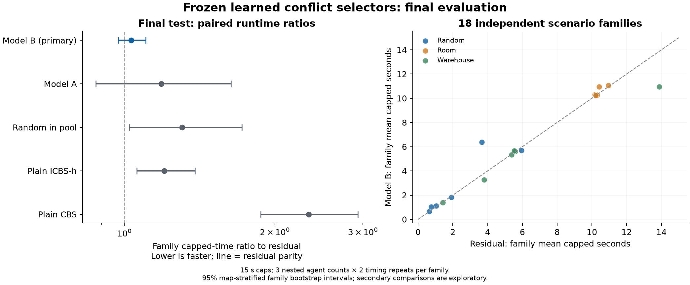

# Final research report: learned conflict prioritization for optimal MAPF

31 October 2026. Base repository revision: `8f26ac31c372a8c4e5a6426fed4e74da997b9676`.

## Main result

**Model B did not establish a speed improvement over residual selection in the frozen final test.** The primary model B / residual geometric family runtime ratio is **1.031**, with a map-stratified bootstrap 95% interval **[0.972, 1.103]**. Both the effect and solved coverage matter: model B solved **74/108 runs** and **37/54 instances in both repeats**, compared with residual's **72/108** and **36/54**. The prespecified primary speed criterion **did not pass**.

The approved project deliverables are complete: repaired search code, a provenance-checked dataset, two fitted models, an untouched-until-frozen final comparison, reproducible analysis and this report. Completion does not imply a successful performance hypothesis. The result applies to these Python implementations on synthetic scenario families from three known maps. It is not evidence of superiority over optimized published MAPF systems or generalization to unseen maps.

## Research question and attribution

The question was whether a cheap learned scorer can select conflicts more effectively than the repository's analytical selector while leaving optimal search mechanisms intact. CBS searches over constraints and solves individual constrained path problems at its low level. The original algorithm and its optimality argument are described by [Sharon et al., Artificial Intelligence 2015](https://www.sciencedirect.com/science/article/pii/S0004370214001386).

Conflict prioritization and bypassing are established ICBS ideas, described by [Boyarski et al., IJCAI 2015](https://www.ijcai.org/Proceedings/15/Papers/110.pdf). Cardinal-conflict aggregation can supply an admissible high-level heuristic, as developed by [Felner et al., ICAPS 2018](https://www2.cs.sfu.ca/~hangma/pub/icaps18.pdf). Our ICBS-h label denotes the local cardinal-priority, bypass and CG/MVC variant; it does not reproduce all published improvements such as meta-agent merging/restart.

Imitating a more expensive conflict oracle follows [Huang, Koenig and Dilkina, AAAI 2021](https://taoanhuang.github.io/files/aaai21c.pdf). Their method uses WDG-based oracle information. Our teacher instead uses CG/MVC and a declared secondary child-bound key. The residual comparator is a cached, f-aware-inspired policy in this repository, not a verified reproduction of every detail or gain in the [f-aware conflict-prioritization paper](https://pathfinding.ai/pdf/bflbhsk-aaai21-facfihfcbs.pdf). The contribution here is an audited empirical adaptation and evaluation, not the invention of learning conflict selection.

## Method and invariants

Agents move or wait on a four-neighbor grid. Vertex collisions and edge swaps are forbidden; agents remain at their goals after their paths finish. The objective is sum of path costs. The repaired implementation uses exact constrained space-time A*, a constraint-derived complete default low-level horizon, explicit incomplete-horizon/time outcomes, full contextual conflict counting and independent solution validation.

All ICBS-h policies keep highest-tier cardinality priority, ordinary two-branch splitting, best-first ordering, CG/MVC lower bounds and pathmax. Model predictions only choose an eligible conflict. They never remove a necessary branch, supply a heuristic value or alter the optimization objective. These mechanisms follow the CBS correctness framework; finite regression tests and cost agreement provide implementation evidence, not a universal proof that every program execution is optimal.

For a conflict between agents i and j, the residual selector uses cached alternative individual path costs and the parent's conflict graph. For each agent a, let `dg_a` be its constrained path-cost increase and `df_a = dg_a + MVC(G without a) - MVC(G)`. Its exact lexicographic key is `(min df, min dg, max df, max dg, degree_sum, pair_frequency, -conflict_time)`, higher preferred. It makes no extra A* calls for this ranking step, but still costs computation.

Model A uses the original analytical-tie/top-three guard and prior repaired ICBS-h descendant-expansion comparisons. Model B uses at most six highest-tier candidates: the full residual winner first, followed by up to five other conflicts selected by a frozen hash rule. Collection and deployment call the same pool function. The matched random-pool policy tests whether the broadened candidate access alone is useful.

For each candidate c, the offline teacher constructs its two ordinary CBS children. For feasible child b, `F_b = max(g_b + MVC(G_b), F_parent)`. The frozen preference is `(min(F_left,F_right), max(F_left,F_right))`, higher first. Ties remain ties. Proven infeasibility is an absent branch with an extended bound; timeout is unknown; a two-branch infeasible node is not used to invent strict labels. The target is a one-step lower-bound preference, **not ground truth about eventual search runtime**.

Both models use fixed pairwise Ridge, alpha 10, no intercept, train-only standardization and equal total pair weight per informative query. Input consists of the existing 24 features, including parent geometry/context and alternative-path quantities already available from conflict classification. Full child teacher bounds are excluded from model inputs. Both saved JSON models reproduced their fitted training-candidate predictions exactly. No parameter, feature, model or candidate-pool change was made from final-test outcomes.

## Dataset and development history

The legacy CSV/model claims were not reused as evidence for the repaired solver. Earlier collection gates failed and remain recorded. Exploratory fitting despite the old gate failure was subsequently authorized explicitly; that did not turn the old failure into a pass.

Model A has 27 strict training comparisons from 10 informative decisions in six families. The replacement teacher dataset has **237 states, 1,064 complete candidate labels and 2,128 feasible child records**. Training comprises 199 states from 30 families, yielding **1,277 strict comparisons from 182 informative decisions in 29 families**. Development comprises 38 states from 11 families and 245 strict comparisons. All 48 planned train/development families were attempted; seven yielded no eligible captured decision and were not replaced based on outcomes.

All child paths, constraints and costs were checked, all saved features and candidate pools replayed, and every child MVC was recomputed using a separate exhaustive vertex-cover routine. The training and development families are disjoint. Final families 24–29 on each map were sealed until the approved solver/model configuration and final schedule were frozen.

This dataset is useful for reproducible proxy-teacher experiments. It is small and dependent: multiple decisions belong to the same family, the collector follows residual selection, only early eligible states are sampled, and all maps are known during development. A large count of candidate pairs does not create an equally large count of independent problems.

Development already cautioned against equating imitation with usefulness: model B's pair accuracy was 85.3%, versus 87.5% for analytical ordering on the same teacher pairs. Models A and B were respectively 3.8% and 9.0% slower than residual on development mean capped time, with the same solved count. These development results motivated honest final measurement, not test-driven redesign.

## Frozen final experiment

- **Inputs:** 54 instances from 18 held-out families, six families per map on `random-32-32-20`, `room-32-32-4`, and `warehouse-32-32-aisles`. Each family supplies nested 16/24/32-agent variants from seeded synthetic starts/goals in the largest connected map component. These are not claimed to be the original Moving AI scenario files.
- **Policies:** plain CBS, plain ICBS-h, residual, random in the revised pool, model A and model B. The expensive direct teacher was evaluated during development and is not in the final matrix.
- **Runs:** two timing repetitions per policy/instance, fixed algorithm seed 71, randomized schedule seed 20261031; **648 analyzed runs**. Repetitions share the algorithm seed and are not independent stochastic trials.
- **Resources:** 15-second end-to-end caps, 4-GiB process memory limit, fresh subprocesses, serial execution, CPU affinity 0 and one numerical-library thread. Model loading and online feature construction are included. Hardware: Intel(R) Core(TM) Ultra 5 125H, 15.5 GiB usable physical RAM, Microsoft Windows 11 Home Single Language; Python 3.12.14. Background system activity and thermal state are not fully controlled. Figure-only dependencies were installed in an isolated directory during the early part of the batch; solver dependencies were unchanged, but this setup could contribute background load. All scheduled results are retained. A cleaner replication should install every dependency before benchmarking.
- **Correctness:** the worker and controller independently validate returned paths; analysis revalidates them and compares costs. **366 returned solutions** passed, with no solved-cost disagreements.

For each run, capped time is its measured wall time if solved, capped at 15 seconds; otherwise it is 15 seconds. First average the six observations (three agent counts × two repeats) inside each family. The primary estimate is the geometric mean of the 18 model-B/residual family ratios. The 95% interval resamples six families with replacement separately within each map, using 10,000 replicates and fixed seed 20261031. It does not treat the 648 runs as independent samples.

A speed claim was permitted only if that interval lies below one and model B has no fewer solved runs or instances solved in both repeats. Model A and other policy comparisons are secondary and exploratory, with no multiplicity adjustment. Memory is a separate conditional analysis over matched instances solved by both compared policies in both repeats.

## Final results

| Policy | Solved runs | Instances solved twice | Mean capped s | Geometric family ratio | Family bootstrap 95% interval |
|---|---:|---:|---:|---:|---:|
| Plain CBS | 36/108 | 18/54 | 10.745 | 2.337 | [1.873, 2.930] |
| Plain ICBS-h | 60/108 | 30/54 | 7.232 | 1.201 | [1.058, 1.384] |
| Residual analytical | 72/108 | 36/54 | 6.212 | 1.000 | [1.000, 1.000] |
| Random in revised pool | 62/108 | 31/54 | 7.294 | 1.304 | [1.022, 1.717] |
| Model A: continuation / old guard | 62/108 | 31/54 | 6.982 | 1.185 | [0.876, 1.635] |
| Model B: child teacher / revised pool | 74/108 | 37/54 | 6.220 | 1.031 | [0.972, 1.103] |

Ratios use residual selection as the denominator; below one is better. Model B's arithmetic mean capped-time ratio is 1.001, a different summary from the primary geometric family ratio. It won on 7 families, lost on 11, and tied on 0. Equal capped values can conceal different latent times when both policies fail.

Model A's secondary geometric family ratio is 1.185, with interval [0.876, 1.635] and 62/108 solved runs. Its result is reported regardless of direction; it is not used to replace the prespecified primary model after viewing test outcomes.

| Map | Residual solved runs | Model B solved runs | Residual capped s | Model B capped s |
|---|---:|---:|---:|---:|
| random-32-32-20 | 34/36 | 34/36 | 2.328 | 2.783 |
| room-32-32-4 | 12/36 | 12/36 | 10.378 | 10.506 |
| warehouse-32-32-aisles | 26/36 | 28/36 | 5.930 | 5.371 |

| Agents | Residual solved runs | Model B solved runs | Residual capped s | Model B capped s |
|---|---:|---:|---:|---:|
| 16 | 36/36 | 36/36 | 1.298 | 1.170 |
| 24 | 22/36 | 24/36 | 6.492 | 6.335 |
| 32 | 14/36 | 14/36 | 10.847 | 11.154 |

### Memory and search work

| Policy | Median all-run peak MiB | Median matched family memory ratio | Matched instances / families |
|---|---:|---:|---:|
| Plain CBS | 52.65 | 1.025 | 18 / 13 |
| Plain ICBS-h | 33.73 | 1.001 | 30 / 16 |
| Residual analytical | 33.37 | 1.000 | 36 / 18 |
| Random in revised pool | 35.30 | 1.054 | 30 / 16 |
| Model A: continuation / old guard | 36.89 | 1.091 | 30 / 17 |
| Model B: child teacher / revised pool | 37.15 | 1.094 | 36 / 18 |

The pooled peak column mixes completion outcomes and includes the Python interpreter and imported libraries. The paired ratio averages peak bytes over matched completion cases within each family, then reports the median family ratio. It is conditioned on shared solvability and cannot justify an unconditional memory-saving claim. Observed memory for killed workers may miss a final peak. Node counts cannot substitute for measured memory.

On 36 instances solved by both model B and residual in both repeats, the ratio of their mean expansions is **0.986**. This is a matched solved-subset diagnostic; it excludes censored searches and is not the primary endpoint.

| Learned policy | Runs returning telemetry | Model calls | Feature seconds | Prediction seconds |
|---|---:|---:|---:|---:|
| Model A: continuation / old guard | 62/108 | 1074 | 1.160 | 0.047 |
| Model B: child teacher / revised pool | 74/108 | 3196 | 1.840 | 0.151 |

Telemetry sums include only workers that returned it. Missing data from killed workers are not zeros. Full wall time, rather than prediction time alone, determines whether learning is useful. Improving a cheap dot product cannot by itself repair poor conflict choices.

The new policies' authoritative telemetry is the `selector_stats` object. Legacy top-level `ml_tiebreaks` and `analytical_shortcircuits` fields are not populated by the new selector and default to zero; they are not used in this analysis and must not be interpreted as absence of ML activity. This instrumentation compatibility limitation does not change the selected conflicts or timed runs.

## Integrity, timing deviations and compute

There were **0 initial timing faults**, affecting **0 instance blocks**, and **0 replacement runs**. The frozen rule was to preserve all original attempts and replace all 12 policy/repetition runs for an affected instance once when wall time exceeded the cap by more than one second, provided the remaining budget allowed it. Final timing validity: **True**. The largest measured launch delay was 0.106 seconds; largest recorded monitor-loop gap was 0.145 seconds.

The preceding development experiment suffered Modern Standby interruptions; its original and replacement data remain in that phase's folder. The final budget controller temporarily requests system/display wakefulness and releases that request on exit. Persistent power settings are not modified. All initial final-test attempts are in `initial_runs.jsonl`; any retries are separate; `analysis_rows.jsonl` is derived and explicitly identified as such.

The approved final phase reserved **2.849 of 3 CPU-hours**. Cumulative conservative reservations are **6.082 of 8 CPU-hours**. Full wall-cap reservations are charged even if work ends early. Worker CPU measurements across raw final attempts sum to 1.220 hours, a lower bound when workers were killed and excluding controller/report work. It must not be confused with the reservation ledger.

The unchanged solver/model source was hash-checked before testing, during execution and afterward. Four new final-harness tests passed on tiny synthetic cases, including comparison with the prior monitor and an independent optimum. The previous 32 recovery/ML regression tests remain applicable to the identical solver source. The final statistics were recomputed by the read-only submission verifier. The archive is CRC-checked and every packaged file has a manifest hash. Remote CI has not run; no remote publishing occurred.

## Candid assessment and remaining work

**Useful dataset:** yes, for the stated one-step teacher-imitation question. **Real trained ML:** yes. **Supported final speed improvement:** no under the prespecified criterion. **General memory improvement or state-of-the-art superiority:** not established by this study. **Deployment readiness:** a bounded research prototype, not a production-certified multi-robot planner.

An A+ grade cannot be guaranteed without the supervisor's rubric. The strongest defensible contribution is the repaired, reproducible evaluation and its honest result. A claim that the method is inherently faster and smaller than existing MAPF algorithms would overstate the evidence. The literature already contains learned conflict selection, so novelty must be framed as an adaptation and empirical investigation.

For a subsequent research iteration, prioritize three questions: (1) do teacher-preferred choices reduce matched eventual search work, not just one-step bounds; (2) does learning add value beyond analytical ordering when candidate access is held fixed; and (3) how does the repaired Python engine compare with a correctly configured external reference implementation? Profile feature construction and search separately, collect decisions across more independent families/maps, and evaluate any redesigned method on a **new holdout**. The final test in this package is now consumed. A larger model or triplet feature set is not a justified automatic next step without evidence for those questions.

The current approved work is complete. The package supplies a working demo, both models, data, raw results, source snapshots, tests, analysis and submission guidance. Further experiments require a new design and budget; this report does not silently extend the current scope.

## Provenance

Frozen protocol SHA-256: `7d89046a22eb4d628440a7900dc5dd375b9cb00444a0ac2221294025b15cbd00`.

Unchanged solver-source SHA-256: `3c638b8edee05ef3643edf29ffc68308b6c85a271e0edfb32e944c8992a0b8a2`.

Model A SHA-256: `c188835312f7d4871e012b6c0376a0cd3f2844067e08592bddc8707a74da526f`.

Model B SHA-256: `4d6d5f237cab841a6145a1ef731074e0e90648f18818b7a67c0ca3a127cd18d3`.

See `SOURCE_MANIFEST.json`, `results/recovery/final_study/frozen_source_manifest.json`, the protocol/schedule, and the append-only compute ledger for file-level evidence.
